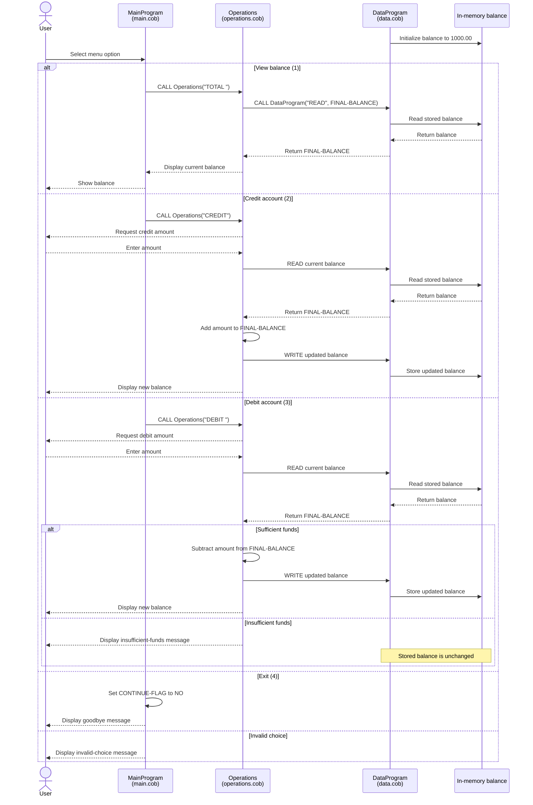

# COBOL Account Management Documentation

## Purpose

This directory documents the COBOL account management sample. The program provides a simple interactive workflow for viewing an account balance, crediting an account, and debiting an account.

## Source Files

### `src/cobol/main.cob`

`MainProgram` is the interactive entry point.

Key responsibilities:

- Displays the account management menu.
- Accepts a user choice from 1 through 4.
- Dispatches the selected action to `Operations`:
  - `TOTAL ` for viewing the balance.
  - `CREDIT` for adding funds.
  - `DEBIT ` for removing funds.
- Repeats until the user selects Exit.
- Displays an error for any choice outside 1 through 4.

### `src/cobol/operations.cob`

`Operations` implements account actions selected by `MainProgram`.

Key operations:

- `TOTAL `: Reads the stored balance and displays it.
- `CREDIT`: Reads an amount, loads the current balance, adds the amount, stores the new balance, and displays the result.
- `DEBIT `: Reads an amount, loads the current balance, and subtracts the amount only when sufficient funds are available.

The operation name is passed through the `PASSED-OPERATION` linkage item and is six characters wide, so some operation values include trailing spaces.

### `src/cobol/data.cob`

`DataProgram` provides the balance storage boundary.

Key operations:

- `READ`: Copies the stored balance into the caller-provided `BALANCE` field.
- `WRITE`: Replaces the stored balance with the caller-provided `BALANCE` field.

The current storage is an in-memory working-storage value initialized to `1000.00`. It is not persisted to a file or database, so the balance resets when the program restarts.

## Business Rules for Student Accounts

The current source code does not identify account holders as students and does not contain student-specific fields, eligibility checks, fees, limits, or discounts. Therefore, a student account currently follows the same rules as every other account:

1. The initial balance is `1000.00`.
2. A credit adds the entered amount to the current balance.
3. A debit is allowed only when the current balance is greater than or equal to the requested amount.
4. A debit that exceeds the current balance is rejected with an insufficient-funds message, and the stored balance is unchanged.
5. The balance is held only in memory and resets to `1000.00` after a restart.
6. The program does not validate that credit or debit amounts are positive, so non-positive input is not explicitly prevented.
7. The program does not authenticate users or enforce student enrollment status.

Any future student-account policy, such as a minimum balance, daily debit limit, tuition-related credit, or enrollment check, would need to be added to the COBOL implementation before it can be considered an enforced business rule.

## Application Data Flow

